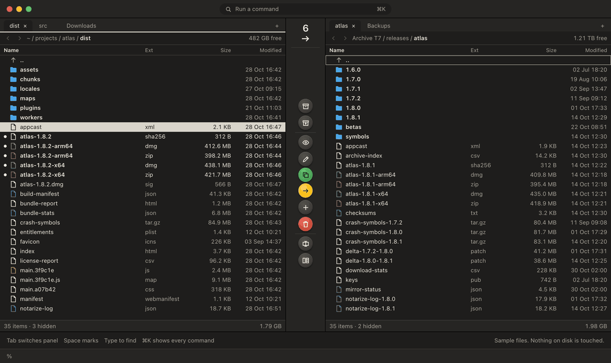
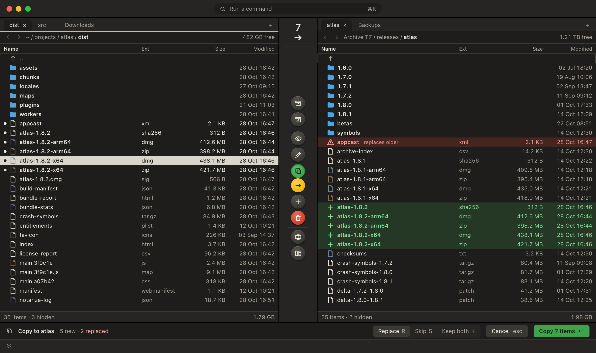
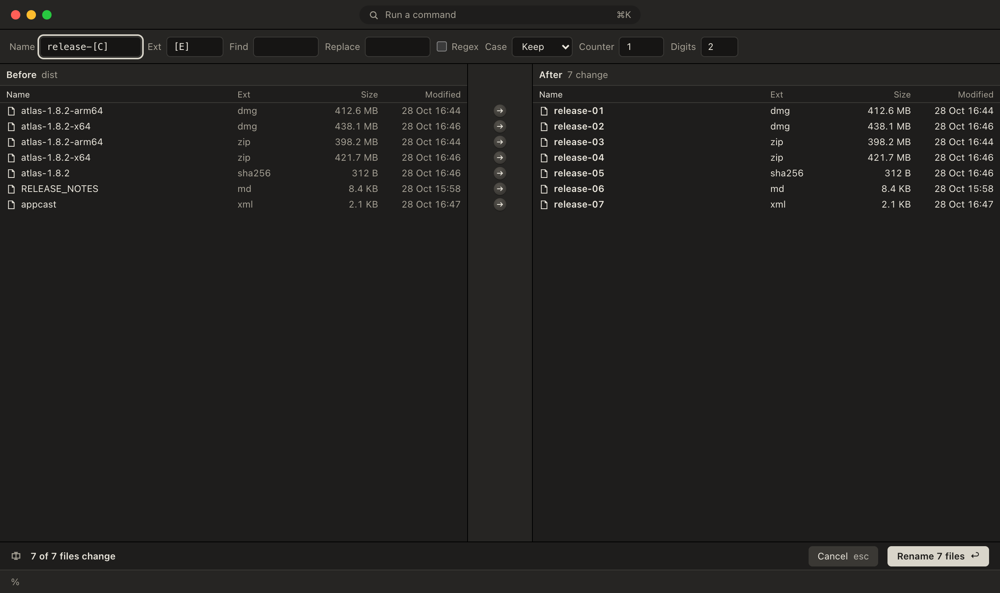
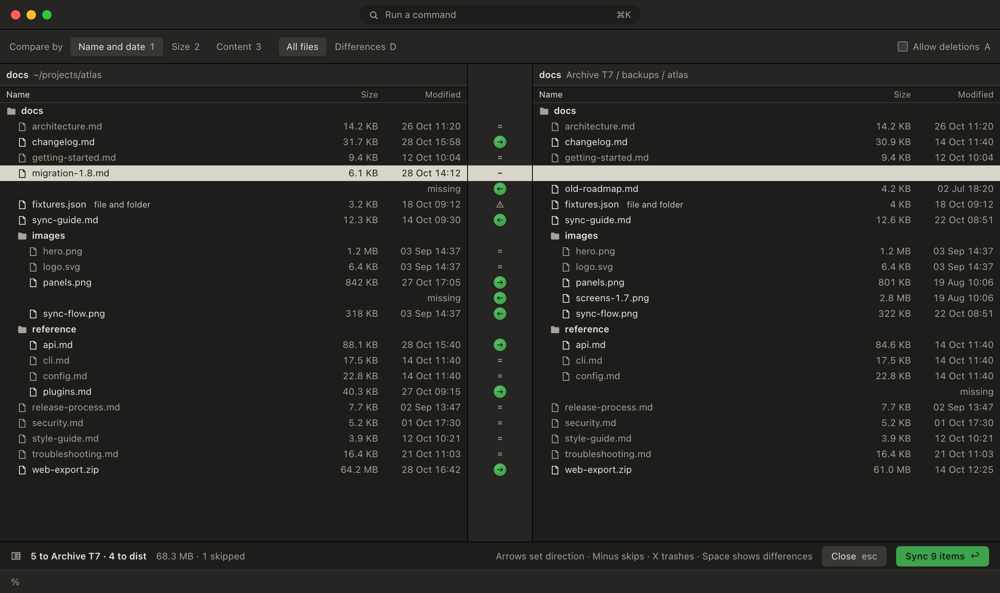

# Commander

A keyboard-first, dual-panel file manager for macOS, inspired by Total Commander.

Commander keeps two folders on screen, so you always see where files are coming from and where they're going. Bulk work is previewed in the destination before anything happens, and every action has a keyboard route.

<a href="docs/media/commander-demo.mp4">
  
</a>

<sub>The demo and screenshots come from the [design prototype](design/commander.html), which uses sample files. The native app follows the same design. [Watch the MP4](docs/media/commander-demo.mp4) for full resolution.</sub>

## Why Commander

- **See the result first.** Copies, moves, renames, compress, extract and sync all show what they'll do before they run. New files appear in the destination, and anything that would be overwritten is flagged.
- **Keep your hands on the keyboard.** Every action has a shortcut and a command palette entry. Every F-key action also has a ⌘ shortcut, because Mac laptops treat F-keys as media keys by default.
- **See more at once.** Rows are 20 points tall, on one column grid shared by both panels.
- **Know what a key will do.** Green copies or creates, yellow moves, and red removes or overwrites. Those colours are always paired with an icon or arrow.

<picture>
  <source media="(prefers-color-scheme: dark)" srcset="docs/media/commander-dark.png">
  <source media="(prefers-color-scheme: light)" srcset="docs/media/commander-light.png">
  
</picture>

## Features

**Files and panels**
- Two panels, each with tabs you can reorder or move across
- Marking, marking by pattern, invert, and quick search by typing
- Sorting, hidden files, back and forward history, and go to path
- Real file icons, a right-click menu, and Open With

**File operations**
- Copy, move, Trash, and permanent delete with explicit confirmation
- Replace, Skip or Keep Both for conflicts
- A job queue with progress, so a second operation waits for the first
- Inline rename with undo, and multi-rename with patterns, find and replace, regex, case and counters

**Archives**
- Browse archives as read-only folders: ZIP, TAR, TGZ, TBZ, TXZ, 7Z and RAR, plus single GZ, BZ2 and XZ files
- Create ZIP and TAR.GZ archives
- Downloaded archives pass their macOS quarantine mark on to what comes out, so Gatekeeper still checks an app from inside

**Compare, find and view**
- Compare two folders by name and date, size or content, then sync them with a preview of every row
- Line-by-line differences for text files
- Find Files by name and content, with results in a tab
- A paged text and hex viewer that opens multi-GB files at once, and Quick Look for images, PDFs and media

**Everything else**
- A command palette and a command line that runs in the current folder
- Open Terminal here and copy path
- Light and dark themes, with reduced motion support

| Preview before running | Multi-rename | Compare and sync |
|---|---|---|
|  |  |  |

## Your files come first

Data loss is the worst bug a file manager can have, so these rules apply to every file operation:

- Overwrites go through a temporary file and a rename, so a failed copy never damages the original.
- A move across drives deletes the source only after the copy has succeeded and reached the disk.
- A file changed after the preview is left alone.
- Symlinks are never followed during recursive copies or deletes.
- Trash is the default. Permanent delete needs explicit confirmation.
- Every archive path is checked, so nothing unpacks outside the target folder.
- The code that touches files is tested against real files and disk images, not mocks.

Commander is still pre-release software, so keep backups of anything you can't lose.

## Keyboard

| Action | Keys |
|---|---|
| Switch panel | Tab |
| Mark | Space |
| Mark or unmark by pattern | + / - |
| Command palette | ⌘K |
| Command line | ⌘L |
| View beside | F3 or ⌘Y |
| Edit | F4 or ⌘E |
| Copy to other panel | F5 or ⌘⇧C |
| Move to other panel | F6 or ⌘⇧M |
| New folder | F7 or ⌘⇧N |
| Move to Trash | F8 or ⌘⌫ |
| Rename in place | ⇧F6 or ⌥⌘R |
| Multi-rename | ⌘⇧R |
| Compress / extract | ⌘⇧P / ⌘⇧U |
| Compare and sync | ⌘⇧D |
| Find Files | ⌘F |
| Go to path | ⌘⇧G |
| Hidden files | ⌘⇧. |

The full list is in [PLAN.md](PLAN.md#keyboard), and ⌘K shows every command.

## Build it

You need macOS 26 or later and Xcode 26 or later. Commander has been built with Xcode 27.2. It has no third-party dependencies, only macOS and the system's libarchive.

```bash
git clone https://github.com/torosent/commander.git
```

```bash
cd commander
```

Build a release copy, which appears at `build/release/Build/Products/Release/Commander.app`:

```bash
scripts/release.sh
```

That build is ad hoc signed and runs only on your Mac. If you have an Apple Development certificate, sign with it so macOS keeps Commander's permissions between builds:

```bash
IDENTITY="Apple Development: you@example.com (ABCDE12345)" scripts/release.sh
```

To reach protected folders such as Mail or Safari data, give Commander **Full Disk Access** in System Settings under Privacy & Security.

## Privacy

Commander contains no networking code, analytics or telemetry. It runs outside the App Sandbox because a file manager has to reach your files. The command line runs what you type through your login shell.

## Development

Run the tests:

```bash
swift test --package-path Packages/CommanderCore
```

Build the app:

```bash
xcodebuild -project Commander.xcodeproj -scheme Commander build
```

It's written in Swift 6 with strict concurrency. SwiftUI handles the window, dialogs and settings, and AppKit's `NSTableView` handles the file panels. All logic lives in the `CommanderCore` package, which has no UI imports, so it can be tested without launching the app.

| Path | What's there |
|---|---|
| [`Commander/`](Commander) | The app: windows, panels, key column, dialogs and menus |
| [`Packages/CommanderCore/`](Packages/CommanderCore) | File operations, archives, compare, search, viewer and their tests |
| [`design/commander.html`](design/commander.html) | A clickable prototype of every screen, using sample data |
| [`PLAN.md`](PLAN.md) | Decisions, scope, the full keyboard map and milestones |
| [`DESIGN.md`](DESIGN.md) | The design system |

FTP and SFTP, plugins, branch view and thumbnail view are outside v1.

## License

[MIT](LICENSE)
